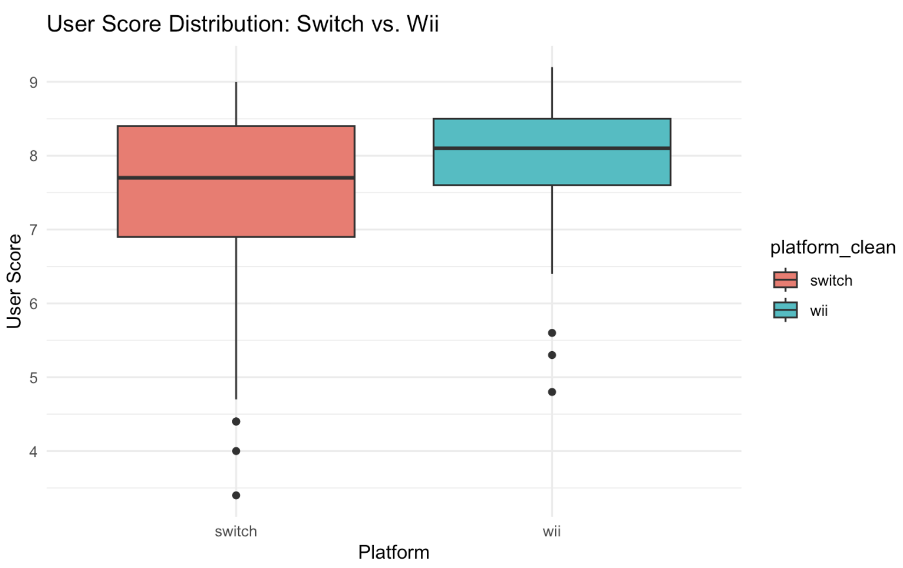
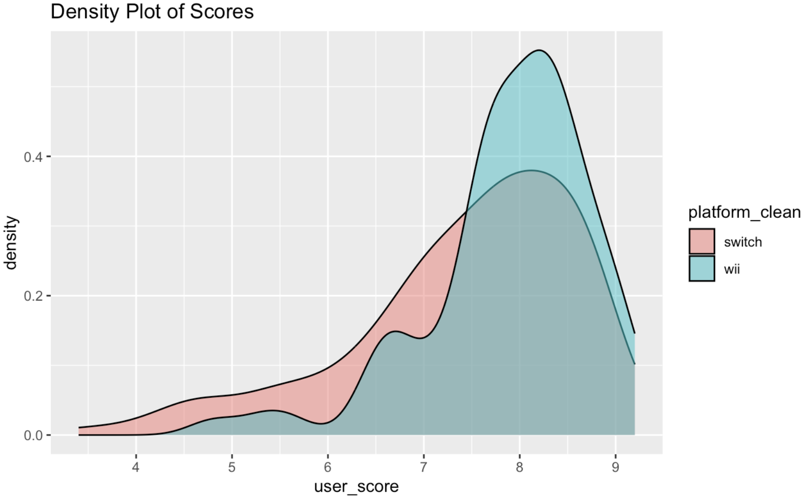
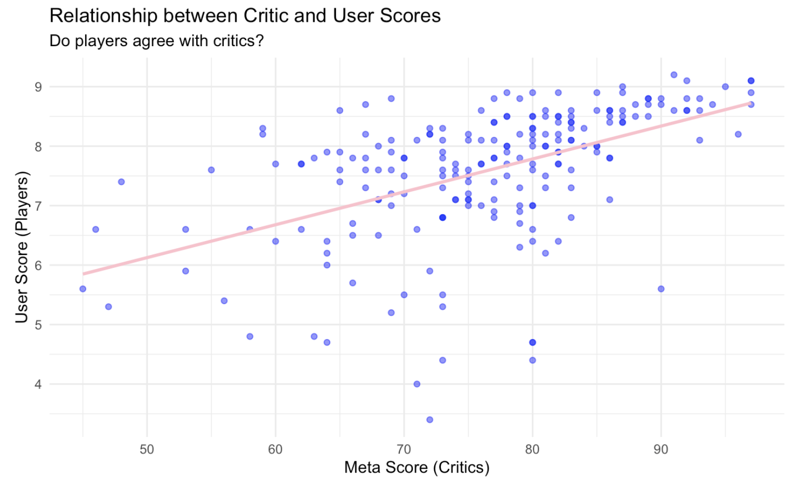
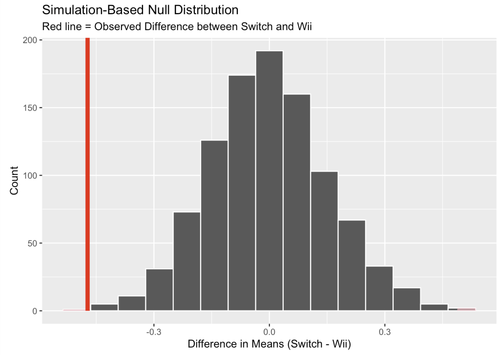

# Nintendo Wii vs. Switch: Do Players Rate Newer Games Higher?

A statistical comparison of user ratings for Nintendo Wii and Switch games in R: correlation, t-test, linear regression, and a permutation test.

**Skills shown:** data cleaning with `tidyverse`, exploratory visualization (`ggplot2`), hypothesis testing, linear regression with `moderndive`, simulation-based inference with `infer`, regression assumption checks, communicating results.

## Question

Is there a significant difference in the average **user score** between Nintendo Wii (2006) and Nintendo Switch (2017) games? My initial guess was that the newer Switch would score higher.

## Data

[Nintendo Games](https://www.kaggle.com/datasets/joebeachcapital/nintendo-games) from Kaggle (1,094 games with critic `meta_score` and player `user_score`). After keeping only Wii and Switch games with both scores, **211 games** remain: 134 Switch and 77 Wii.

## Approach

1. **Correlation:** are critic and player scores the same thing? (r = 0.506, only moderate, so I used player scores to capture player sentiment.)
2. **Visualization:** boxplot and density plot of user scores by console.
3. **Welch t-test** on the difference in means.
4. **Linear regression** to quantify the effect size.
5. **Permutation test** (1,000 shuffles) to confirm the result without assuming normality, plus a residual plot to check constant variance.

## Results

| | Wii | Switch |
|---|---|---|
| Games analyzed | 77 | 134 |
| Mean user score | 7.89 | 7.42 |

| Test | Result |
|---|---|
| Welch t-test | p = 0.001; 95% CI for the difference: 0.19 to 0.75 points |
| Linear regression | Wii scores 0.47 points higher on average (p = 0.002) |
| Permutation test | p = 0.002 |

**Wii games are rated significantly higher than Switch games, the opposite of my initial guess.** The Wii scores cluster tightly around 8, while Switch scores are lower and more spread out.

### Figures

<table>
  <tr>
    <td valign="top"></td>
    <td valign="top"></td>
  </tr>
  <tr>
    <td align="center">Wii median is higher; Switch is more spread out</td>
    <td align="center">Wii peaks sharply near 8</td>
  </tr>
  <tr>
    <td valign="top"></td>
    <td valign="top"></td>
  </tr>
  <tr>
    <td align="center">Critic vs. player scores: moderate correlation (r = 0.506)</td>
    <td align="center">Permutation test: observed difference vs. simulated null</td>
  </tr>
</table>

## Limitations

- **Nostalgia:** people rating Wii games today may remember them more fondly than they deserve.
- **Sample bias:** the Switch list is larger and more recent, so it likely includes more average or low-budget titles; the Wii list may lean toward well-known classics.

The difference is statistically significant, but it describes this dataset, not which console is better.

## Full write-up

- [Report (PDF)](docs/SI_544_Final_Project_Report_Chen.pdf): methods, figures, and discussion
- [Presentation slides (PDF)](docs/SI_544_Final_Project.pdf)
- [Analysis code (R Markdown)](544_Final_Project.Rmd)

## Run it yourself

1. Download `NintendoGames.csv` from the [Kaggle page](https://www.kaggle.com/datasets/joebeachcapital/nintendo-games) and put it in the same folder as the `.Rmd` file.
2. Install the packages: `install.packages(c("tidyverse", "moderndive", "infer"))`
3. Open `544_Final_Project.Rmd` in RStudio and click **Knit**.